# Office 365 Excel Extension - Architecture Documentation

**Version:** 2.0.28 
**Java Version:** 21  
**Last Updated:** November 11, 2025

---

## Table of Contents

1. [Overview](#overview)
2. [Architecture Layers](#architecture-layers)
3. [Component Diagrams](#component-diagrams)
4. [Data Flow](#data-flow)
5. [Authentication Flow](#authentication-flow)
6. [Error Handling Architecture](#error-handling-architecture)
7. [Batch Processing Architecture](#batch-processing-architecture)
8. [Performance Characteristics](#performance-characteristics)
9. [Limitations](#limitations)
10. [Error Scenarios](#error-scenarios)

---

## Overview

The Office 365 Excel extension is built on a **5-layer clean architecture** pattern that provides separation of concerns, testability, and maintainability. The extension integrates with Microsoft Graph API to provide comprehensive Excel file manipulation capabilities.

### Key Architectural Principles

- **Separation of Concerns**: Each layer has a distinct responsibility
- **Dependency Injection**: HK2 framework for loose coupling
- **Facade Pattern**: Simplified interfaces for complex subsystems
- **Factory Pattern**: Object creation abstraction
- **Strategy Pattern**: Pluggable validation and error handling
- **Observer Pattern**: Event-driven async operations

### Technology Stack

| Component | Technology | Version |
|-----------|-----------|---------|
| Language | Java | 21 |
| Framework | Krista Service APIs | 1.0.115 |
| Graph API | Microsoft Graph SDK | 5.20.0 |
| Authentication | MSAL4J | 1.13.3 |
| OAuth | ScribeJava | 8.3.3 |
| HTTP Client | OkHttp | 4.9.3 |
| DI Container | HK2 | 3.0.3 |
| JSON Processing | Gson | 2.8.9 |

---

## Architecture Layers

### Layer 1: Catalog Layer (Presentation)

**Purpose**: Exposes catalog requests to Krista workflows

**Components**:
- `SheetArea.java` - Sheet operations (50+ requests)
- `TableArea.java` - Table operations (30+ requests)
- `SharedArea.java` - Shared drive operations (20+ requests)
- `SheetAreaSubCatalogRequests.java` - Retry/reentry handlers
- `TableAreaSubCatalogRequests.java` - Retry/reentry handlers
- `SharedAreaSubCatalogRequests.java` - Retry/reentry handlers

**Responsibilities**:
- Request parameter validation
- Catalog request annotations
- Async task management
- Thread local context propagation
- Event handling for async operations

**Key Patterns**:
- **@CatalogRequest** annotations for workflow integration
- **ThreadLocalProxy** for context propagation
- **ExecutorService** for async operations
- **EventHandler** for progress notifications

### Layer 2: Facade Layer (Application)

**Purpose**: Provides simplified interfaces to complex subsystems

**Components**:
- `SheetOperationsFacade.java` - Coordinates sheet operations
- `TableOperationsFacade.java` - Coordinates table operations
- `SharedOperationsFacade.java` - Coordinates shared drive operations
- `AreaOperationHandler.java` - Validation and error handling orchestration

**Responsibilities**:
- Coordinate multiple service calls
- Aggregate validation results
- Manage state for retry flows
- Generate ExtensionResponse objects
- Telemetry and metrics collection

**Key Patterns**:
- **Facade Pattern** for simplified interfaces
- **Template Method** for common operation flows
- **Chain of Responsibility** for validation

### Layer 3: Service Layer (Business Logic)

**Purpose**: Implements core business logic and orchestration

**Components**:
- `WorkbookService.java` - Workbook operations, batch processing
- `WorksheetService.java` - Worksheet CRUD operations
- `TableService.java` - Table operations, VLOOKUP
- `DriveService.java` - OneDrive/SharePoint operations
- `FileService.java` - File upload/download, CSV parsing
- `SheetFormattingService.java` - Cell formatting
- `ExcelService.java` - Excel-specific utilities

**Responsibilities**:
- Business logic implementation
- Batch processing algorithms
- Progress tracking
- Retry logic with exponential backoff
- Data transformation
- Formula execution

**Key Algorithms**:
```java
// Dynamic Batch Sizing
if (totalRows >= 2000) {
    batchSize = 15000 / columnCount;
} else {
    batchSize = Math.max(1, totalRows / 5);
}

// Exponential Backoff
delays = [5s, 10s, 15s, 20s, 25s, 60s] // Network errors
delays = [5s, 10s, 15s, 20s, 25s, 25s] // Other errors
```

### Layer 4: Integration Layer (Infrastructure)

**Purpose**: Handles communication with Microsoft Graph API

**Components**:
- `GraphServiceClientProvider.java` - Graph client management
- `GraphServiceClientProviderFactory.java` - Client factory
- `RestClientProvider.java` - REST API client
- `RestClient.java` - HTTP operations
- `WorkbookOperation.java` - Low-level workbook API calls
- `WorksheetOperation.java` - Low-level worksheet API calls

**Responsibilities**:
- OAuth 2.0 token management
- Access token refresh
- HTTP client configuration
- API request/response handling
- Session management
- Connection pooling

**HTTP Client Configuration**:
```java
OkHttpClient customHttpClient = HttpClients.createDefault(authProvider)
    .newBuilder()
    .connectTimeout(60, TimeUnit.SECONDS)
    .readTimeout(120, TimeUnit.SECONDS)
    .writeTimeout(120, TimeUnit.SECONDS)
    .build();
```

### Layer 5: Infrastructure Layer (Cross-Cutting)

**Purpose**: Provides cross-cutting concerns

**Components**:

**Error Handling**:
- `AuthorizationExceptionHandler.java` - Auth error mapping
- `ExtensionResponseGenerator.java` - Response generation
- `ErrorHandlingStateManager.java` - State management
- `ExtensionResponseFactory.java` - Response factory
- `RemediationActionFactory.java` - Action factory

**Validation**:
- `ValidationOrchestrator.java` - Validation coordination
- `FileIdValidator.java`, `SheetNameValidator.java`, etc. - Specific validators

**State Management**:
- `RefreshTokenStore.java` - Token persistence
- `ErrorHandlingStateManager.java` - Retry state

**Utilities**:
- `TelemetryHelper.java` - Metrics and monitoring
- `DataParser.java` - JSON/data parsing
- `StringUtil.java`, `Tables.java`, `Workbooks.java` - Utilities

**Responsibilities**:
- Authentication error handling
- Validation orchestration
- State persistence
- Telemetry and monitoring
- Data transformation utilities

---

## Component Diagrams

### High-Level Architecture

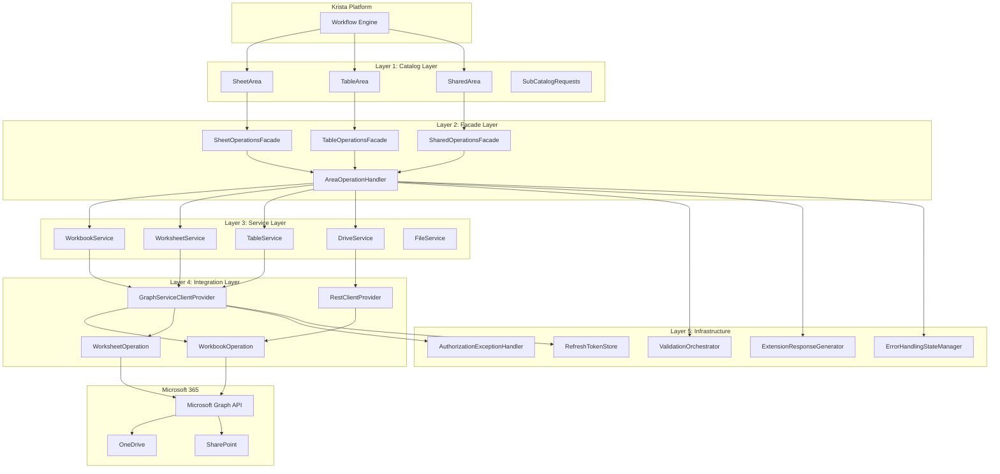

### Dependency Injection Container

```mermaid
graph LR
    subgraph "HK2 Container"
        INJ[Injector]
    end
    
    subgraph "Services"
        WBS[WorkbookService @Service]
        WSS[WorksheetService @Service]
        TS[TableService @Service]
        GSCP[GraphServiceClientProvider @Service]
        RTS[RefreshTokenStore @Service]
        ESM[ErrorHandlingStateManager @Service]
    end
    
    subgraph "Injected Dependencies"
        KVS[KeyValueStore]
        KMC[KristaMediaClient]
        RC[RequestContext]
        INV[Invoker]
    end
    
    INJ -->|@Inject| WBS
    INJ -->|@Inject| WSS
    INJ -->|@Inject| TS
    INJ -->|@Inject| GSCP
    INJ -->|@Inject| RTS
    INJ -->|@Inject| ESM
    
    KVS -->|Injected into| RTS
    KVS -->|Injected into| ESM
    KMC -->|Injected into| WBS
    RC -->|Injected into| GSCP
    INV -->|Injected into| GSCP
```

---

## Data Flow

### Synchronous Request Flow

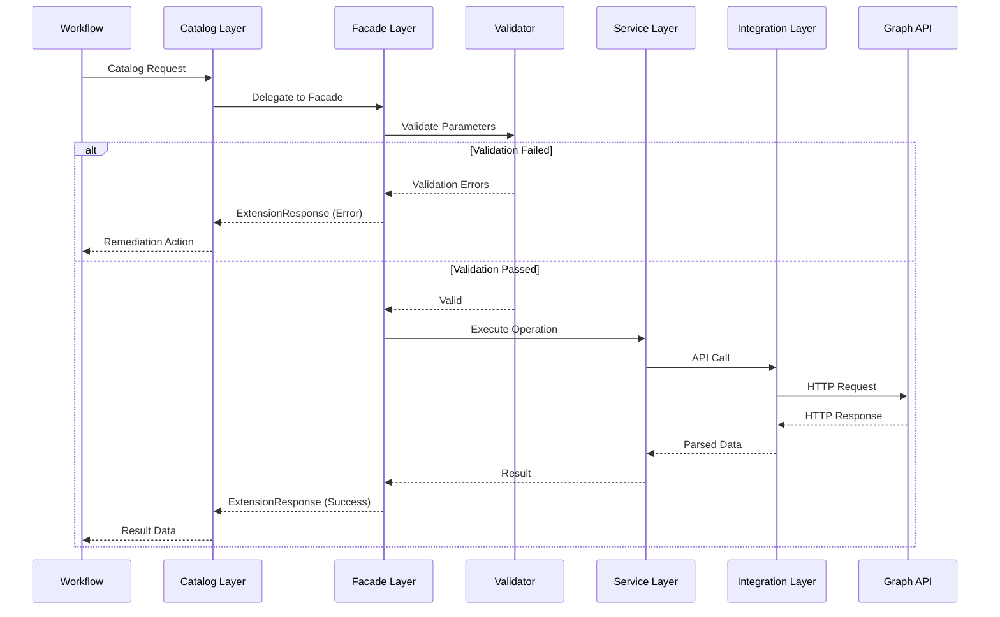

### Asynchronous Request Flow (Batch Processing)

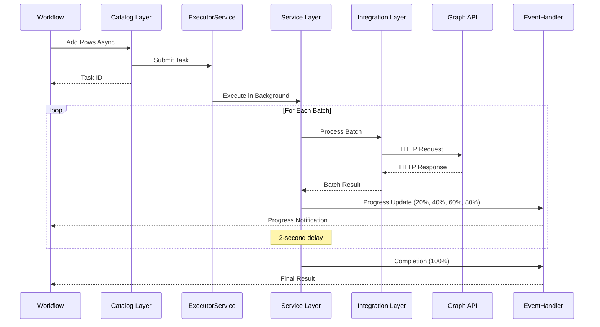

### Retry Flow (Validation Error)

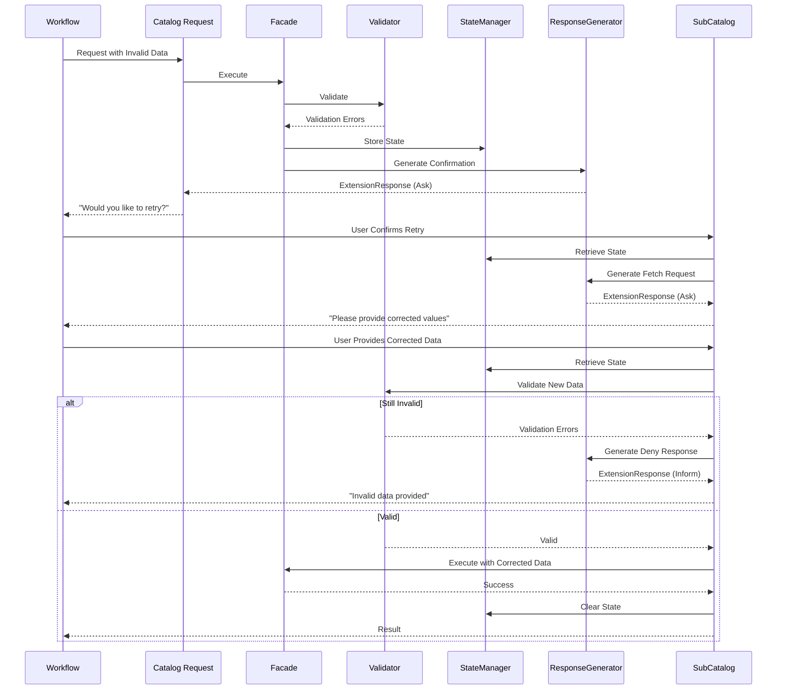

---

## Authentication Flow

### OAuth 2.0 Authorization Flow

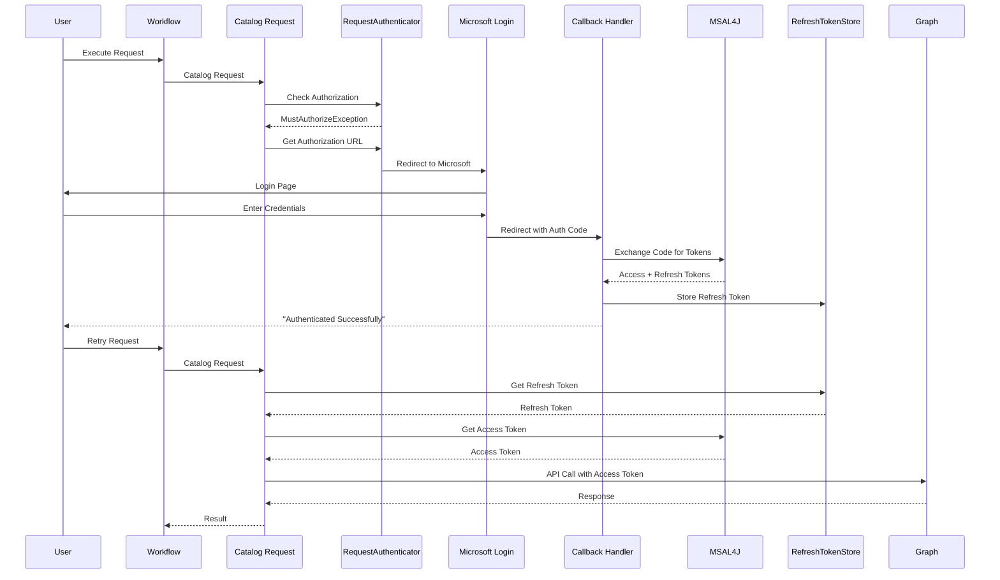

### Token Refresh Flow

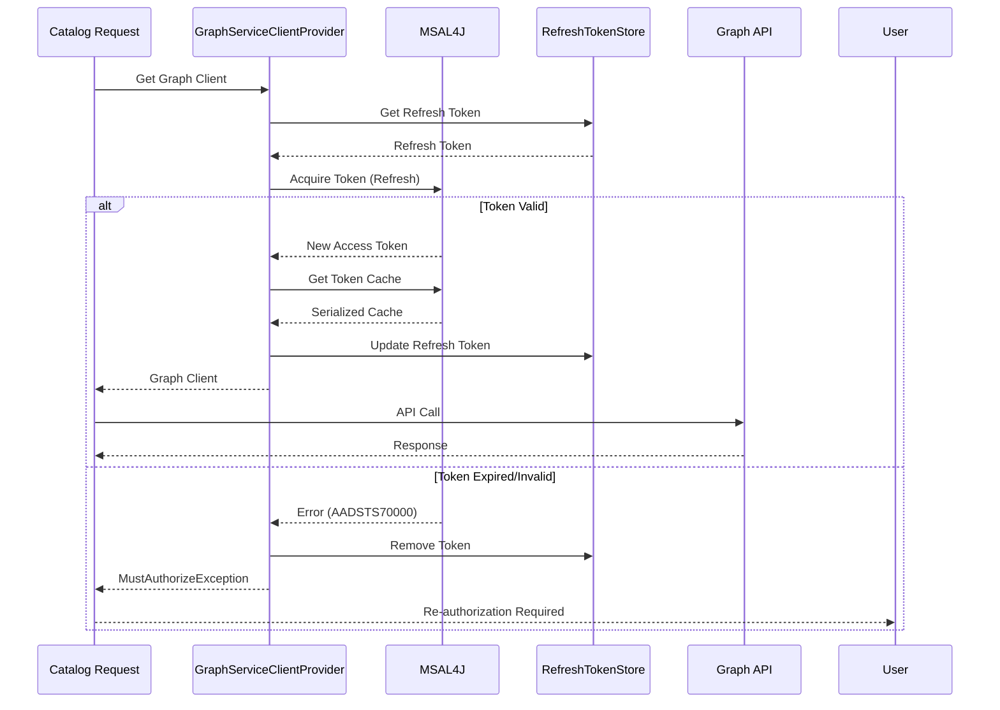

### Authentication Error Handling

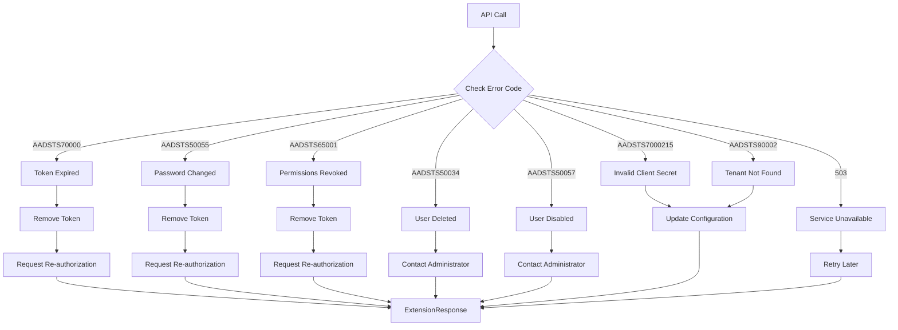

---

## Error Handling Architecture

### Error Handling Components

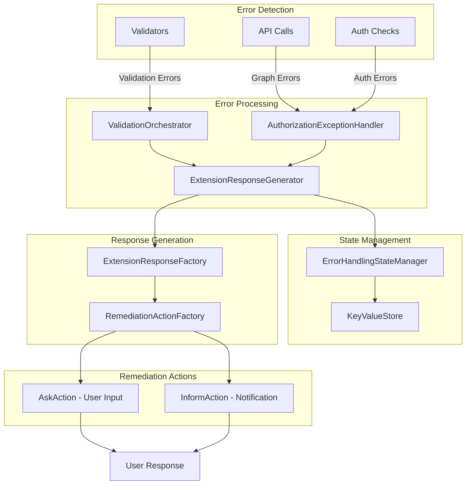

### Error Response Structure

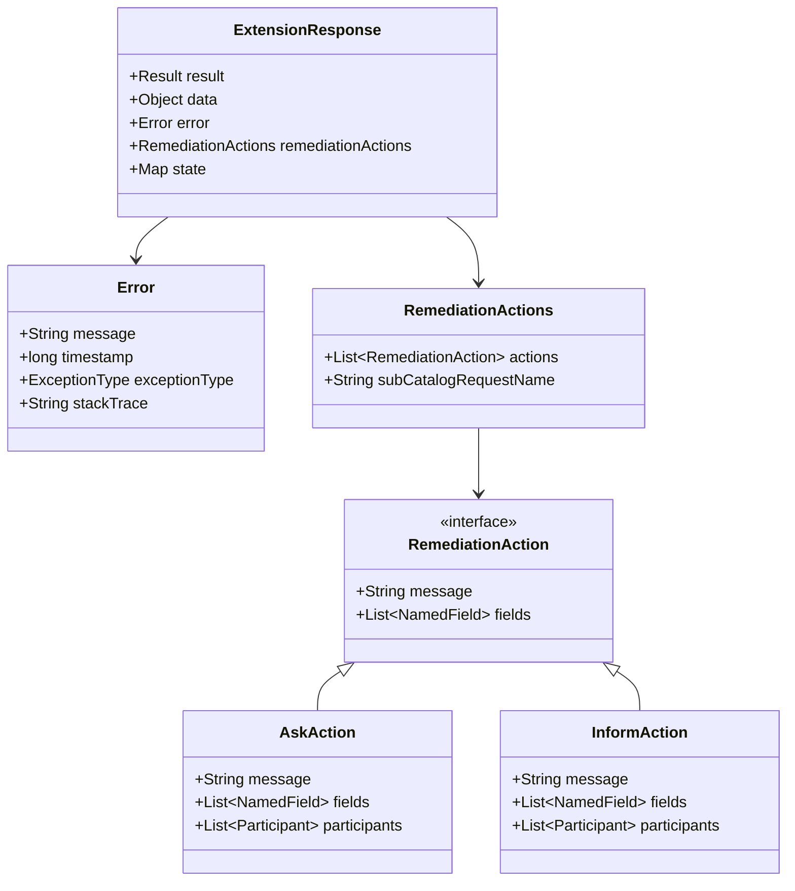

### Validation Flow

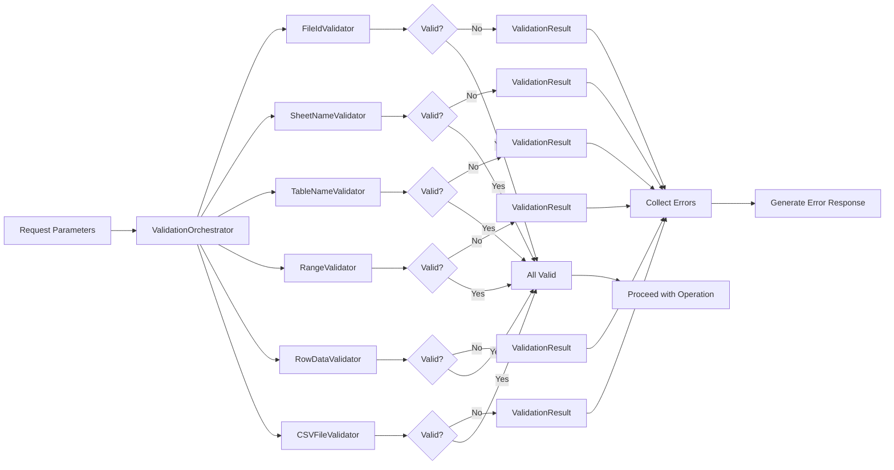

---

## Batch Processing Architecture

### Batch Processing Flow

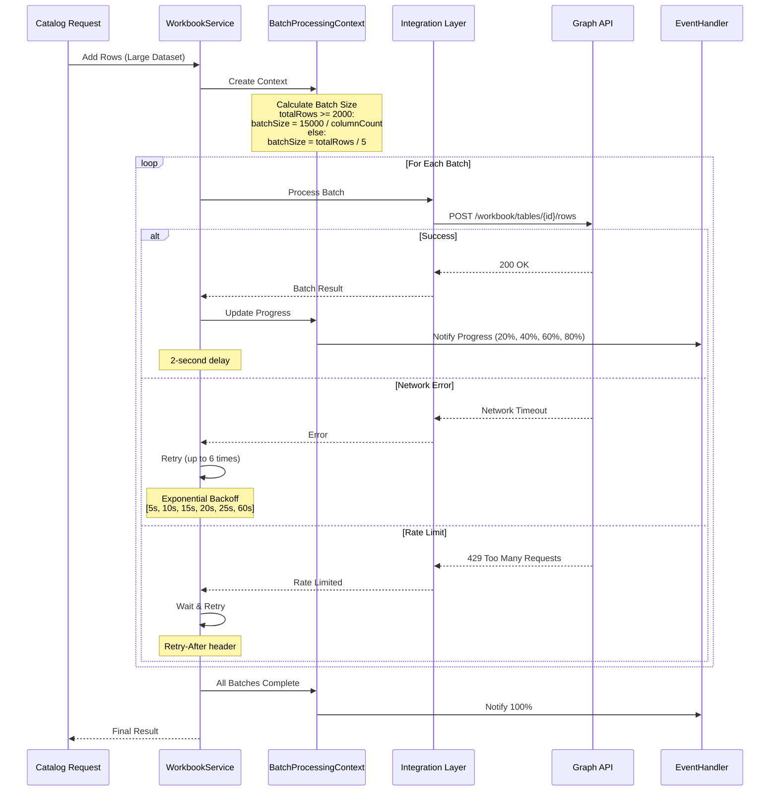

### Batch Size Calculation Algorithm

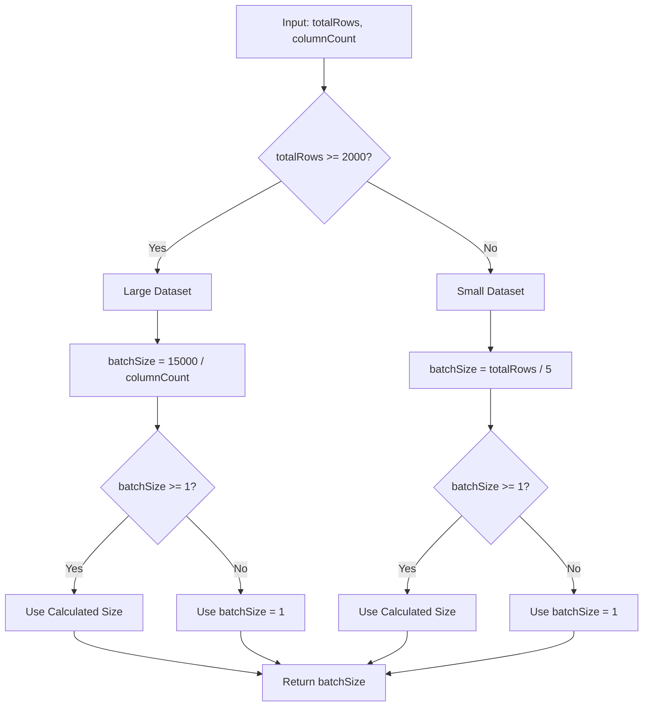

### Retry Logic with Exponential Backoff

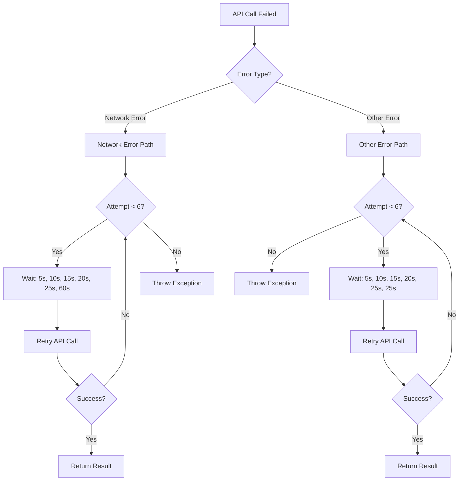

### Progress Tracking

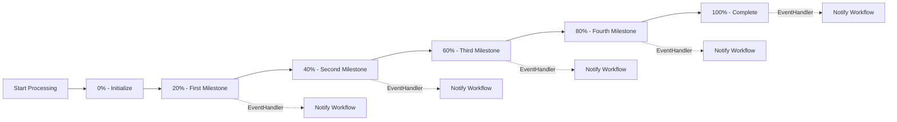

---

## Performance Characteristics

### API Call Performance

| Operation | Avg Response Time | Max Response Time | Throughput |
|-----------|------------------|-------------------|------------|
| Get Cell Value | 200-500ms | 2s | 100 req/min |
| Update Cell | 300-700ms | 3s | 80 req/min |
| Get Range (100 cells) | 500ms-1s | 5s | 60 req/min |
| Add Single Row | 400-800ms | 3s | 75 req/min |
| Add Batch (100 rows) | 2-5s | 15s | 20 req/min |
| Get Table Data (1000 rows) | 1-3s | 10s | 30 req/min |
| VLOOKUP (1000 rows) | 2-5s | 15s | 20 req/min |
| Create Worksheet | 500ms-1s | 3s | 60 req/min |
| Delete Worksheet | 400-800ms | 3s | 75 req/min |
| Upload File (10MB) | 5-15s | 60s | 10 req/min |

### Batch Processing Performance

| Dataset Size | Columns | Batch Size | Total Batches | Est. Time | Memory Usage |
|--------------|---------|------------|---------------|-----------|--------------|
| 100 rows | 5 | 20 | 5 | 30s | 10MB |
| 500 rows | 10 | 100 | 5 | 45s | 25MB |
| 1,000 rows | 5 | 200 | 5 | 60s | 40MB |
| 2,000 rows | 10 | 1,500 | 2 | 90s | 80MB |
| 5,000 rows | 5 | 3,000 | 2 | 2m | 150MB |
| 10,000 rows | 10 | 1,500 | 7 | 5m | 300MB |
| 50,000 rows | 5 | 3,000 | 17 | 20m | 1GB |
| 100,000 rows | 10 | 1,500 | 67 | 60m | 2GB |

**Notes**:
- Includes 2-second delay between batches
- Assumes no retries
- Memory usage is approximate and depends on data complexity

### Concurrent Operations

| Scenario | Max Concurrent | Limitation |
|----------|---------------|------------|
| Concurrent Sessions per User | 5 | Graph API Limit |
| Concurrent Requests per Session | 1 | Sequential Processing |
| Concurrent Async Tasks | 10 | ExecutorService Pool |
| Concurrent File Uploads | 3 | Network Bandwidth |

### Timeout Configuration

| Component | Connect Timeout | Read Timeout | Write Timeout |
|-----------|----------------|--------------|---------------|
| OkHttpClient | 60s | 120s | 120s |
| Graph SDK Default | 10s | 30s | 30s |
| Session Timeout | N/A | 5 minutes | N/A |

---

## Limitations

### Microsoft Graph API Limitations

#### Excel Workbook Limits

| Resource | Limit | Impact |
|----------|-------|--------|
| Max Rows per Worksheet | 1,048,576 | Hard limit |
| Max Columns per Worksheet | 16,384 (XFD) | Hard limit |
| Max Characters per Cell | 32,767 | Truncation |
| Max File Size | 100 MB | Upload failure |
| Max Worksheets per Workbook | 255 | Creation failure |
| Max Named Ranges | 65,536 | Creation failure |
| Max Table Rows | 1,048,576 | Hard limit |
| Max Table Columns | 16,384 | Hard limit |

#### API Rate Limits

| Limit Type | Threshold | Window | Action |
|------------|-----------|--------|--------|
| Requests per User | 2,000 | 1 hour | 429 Throttling |
| Requests per App | 10,000 | 10 minutes | 429 Throttling |
| Concurrent Sessions | 5 | Per User | Session Timeout |
| Session Timeout | 5 minutes | Idle Time | Session Closed |
| File Upload Size | 250 MB | Per Request | 413 Payload Too Large |
| Batch Request Size | 20 requests | Per Batch | 400 Bad Request |

#### Session Management

| Aspect | Limitation | Workaround |
|--------|-----------|------------|
| Session Persistence | 5 minutes idle | Create new session |
| Concurrent Sessions | 5 per user | Queue requests |
| Session Scope | Single workbook | Multiple sessions |
| Session State | Not persisted | Stateless operations |

### Extension-Specific Limitations

#### Batch Processing

| Limitation | Value | Reason |
|------------|-------|--------|
| Max Batch Size | 3,000 rows | Memory constraints |
| Min Batch Size | 1 row | API requirement |
| Batch Delay | 2 seconds | Rate limiting |
| Max Retries | 6 attempts | Prevent infinite loops |
| Max Async Tasks | 10 concurrent | Thread pool size |

#### Data Processing

| Limitation | Value | Impact |
|------------|-------|--------|
| Max CSV File Size | 50 MB | Memory constraints |
| Max JSON Payload | 10 MB | Network constraints |
| Max Formula Length | 8,192 chars | Excel limitation |
| Max Cell Format Rules | 64,000 | Excel limitation |

#### Authentication

| Limitation | Value | Impact |
|------------|-------|--------|
| Token Expiration | 1 hour | Re-authentication |
| Refresh Token Expiration | 90 days | Re-authorization |
| Max Auth Attempts | 3 per minute | Account lockout |

### Performance Limitations

#### Memory Constraints

```
Small Dataset (< 1,000 rows):     < 50 MB
Medium Dataset (1,000-10,000):    50-500 MB
Large Dataset (10,000-50,000):    500 MB - 2 GB
Very Large Dataset (> 50,000):    > 2 GB (may cause OOM)
```

#### Network Constraints

```
Low Bandwidth (< 1 Mbps):         Timeouts likely
Medium Bandwidth (1-10 Mbps):     Acceptable performance
High Bandwidth (> 10 Mbps):       Optimal performance
```

#### Concurrent Processing

```
Single User:                      Up to 5 concurrent sessions
Multiple Users (< 10):            No significant impact
Multiple Users (10-50):           Potential rate limiting
Multiple Users (> 50):            Guaranteed rate limiting
```

---

## Error Scenarios

### Authentication Errors

| Error Code | Description | User Message | Remediation |
|------------|-------------|--------------|-------------|
| AADSTS70000 | Token expired | "Your session has expired. Please sign in again." | Re-authorize |
| AADSTS50055 | Password changed | "Your password was recently changed. Please sign in again." | Re-authorize |
| AADSTS50034 | User not found | "Your account was not found. Please contact your administrator." | Contact Admin |
| AADSTS50057 | User disabled | "Your account has been disabled. Please contact your administrator." | Contact Admin |
| AADSTS65001 | Consent revoked | "Access permissions were revoked. Please sign in again." | Re-authorize |
| AADSTS7000215 | Invalid client secret | "Configuration error. Please contact your administrator." | Update Config |
| AADSTS90002 | Tenant not found | "Organization not found. Please verify your configuration." | Update Config |
| AADSTS50020 | User from wrong tenant | "You signed in with the wrong account. Please use your work account." | Re-authorize |

### Authorization Errors

| HTTP Status | Error Type | Scenario | Remediation |
|-------------|-----------|----------|-------------|
| 401 | Unauthorized | Invalid/expired token | Refresh token or re-authorize |
| 403 | Forbidden | Insufficient permissions | Request admin consent |
| 403 | Forbidden | File access denied | Check sharing permissions |
| 404 | Not Found | File deleted | Verify file exists |
| 404 | Not Found | Worksheet not found | Verify worksheet name |
| 404 | Not Found | Table not found | Verify table name |

### Validation Errors

| Validation Type | Error Condition | User Message | Remediation |
|----------------|-----------------|--------------|-------------|
| File ID | Null or empty | "File ID is required" | Provide file ID |
| File ID | Invalid format | "Invalid file ID format" | Use valid file ID |
| Sheet Name | Null or empty | "Sheet name is required" | Provide sheet name |
| Sheet Name | Contains invalid chars | "Sheet name contains invalid characters: [ ] : * ? / \\" | Remove invalid chars |
| Sheet Name | Too long (> 31 chars) | "Sheet name must be 31 characters or less" | Shorten name |
| Table Name | Null or empty | "Table name is required" | Provide table name |
| Table Name | Invalid format | "Table name must start with a letter and contain only letters, numbers, and underscores" | Fix format |
| Range | Invalid format | "Invalid range format. Expected: A1:B10" | Use valid range |
| Row Data | Empty list | "Row data cannot be empty" | Provide data |
| Row Data | Column mismatch | "Row has 5 columns but table expects 10" | Match columns |
| CSV File | File not found | "CSV file not found at specified path" | Verify path |
| CSV File | Invalid format | "CSV file is not properly formatted" | Fix CSV format |

### Graph API Errors

| HTTP Status | Error Code | Description | Retry Strategy |
|-------------|-----------|-------------|----------------|
| 400 | BadRequest | Invalid request syntax | No retry - fix request |
| 401 | Unauthenticated | Missing/invalid token | Refresh token, retry once |
| 403 | Forbidden | Insufficient permissions | No retry - request consent |
| 404 | NotFound | Resource not found | No retry - verify resource |
| 409 | Conflict | Resource conflict | Retry with exponential backoff |
| 429 | TooManyRequests | Rate limit exceeded | Retry after delay (Retry-After header) |
| 500 | InternalServerError | Server error | Retry up to 6 times |
| 502 | BadGateway | Gateway error | Retry up to 6 times |
| 503 | ServiceUnavailable | Service unavailable | Retry up to 6 times |
| 504 | GatewayTimeout | Gateway timeout | Retry up to 6 times |

### Network Errors

| Error Type | Cause | User Message | Remediation |
|------------|-------|--------------|-------------|
| ConnectException | Cannot reach server | "Unable to connect to Microsoft services. Please check your internet connection." | Check network |
| SocketTimeoutException | Request timeout | "Request timed out. Please try again." | Retry |
| UnknownHostException | DNS resolution failed | "Cannot resolve Microsoft services. Please check your DNS settings." | Check DNS |
| SSLException | SSL/TLS error | "Secure connection failed. Please check your security settings." | Check SSL config |

### Business Logic Errors

| Scenario | Error Condition | User Message | Remediation |
|----------|----------------|--------------|-------------|
| Add Row | Table full (1M rows) | "Table has reached maximum capacity (1,048,576 rows)" | Create new table |
| Add Column | Max columns (16,384) | "Worksheet has reached maximum columns (16,384)" | Create new worksheet |
| Create Worksheet | Max worksheets (255) | "Workbook has reached maximum worksheets (255)" | Create new workbook |
| Cell Value | Too long (> 32,767) | "Cell value exceeds maximum length (32,767 characters)" | Truncate value |
| Formula | Too long (> 8,192) | "Formula exceeds maximum length (8,192 characters)" | Simplify formula |
| File Upload | Too large (> 100MB) | "File size exceeds maximum (100 MB)" | Reduce file size |

### Error Response Examples

#### Validation Error Response

```json
{
  "result": "ERROR",
  "error": {
    "message": "Validation failed for the following fields:\n- Sheet name is required\n- File ID is invalid",
    "timestamp": 1699632000000,
    "exceptionType": "VALIDATION_ERROR"
  },
  "remediationActions": {
    "actions": [
      {
        "type": "ASK",
        "message": "Would you like to provide the correct values?",
        "fields": [
          {
            "name": "sheetName",
            "label": "Sheet Name",
            "type": "TEXT",
            "required": true
          },
          {
            "name": "fileId",
            "label": "File ID",
            "type": "TEXT",
            "required": true
          }
        ]
      }
    ],
    "subCatalogRequestName": "retrySheetOperation"
  }
}
```

#### Authentication Error Response

```json
{
  "result": "ERROR",
  "error": {
    "message": "Your session has expired. Please sign in again.",
    "timestamp": 1699632000000,
    "exceptionType": "MUST_AUTHORIZE"
  },
  "remediationActions": {
    "actions": [
      {
        "type": "INFORM",
        "message": "Click the link below to sign in with your Microsoft account.",
        "fields": [
          {
            "name": "authorizationUrl",
            "label": "Sign In",
            "type": "URL",
            "value": "https://login.microsoftonline.com/..."
          }
        ]
      }
    ]
  }
}
```

#### Rate Limit Error Response

```json
{
  "result": "ERROR",
  "error": {
    "message": "Rate limit exceeded. Please try again in 60 seconds.",
    "timestamp": 1699632000000,
    "exceptionType": "RATE_LIMIT"
  },
  "remediationActions": {
    "actions": [
      {
        "type": "INFORM",
        "message": "You have exceeded the API rate limit. The request will be retried automatically.",
        "fields": [
          {
            "name": "retryAfter",
            "label": "Retry After",
            "type": "TEXT",
            "value": "60 seconds"
          }
        ]
      }
    ]
  }
}
```

---

## Appendix

### Graph API Endpoints Used

| Operation | HTTP Method | Endpoint |
|-----------|-------------|----------|
| Get Workbook | GET | `/me/drive/items/{id}/workbook` |
| Get Worksheet | GET | `/me/drive/items/{id}/workbook/worksheets/{name}` |
| Get Used Range | GET | `/me/drive/items/{id}/workbook/worksheets/{name}/usedRange` |
| Get Range | GET | `/me/drive/items/{id}/workbook/worksheets/{name}/range(address='{range}')` |
| Update Range | PATCH | `/me/drive/items/{id}/workbook/worksheets/{name}/range(address='{range}')` |
| Get Table | GET | `/me/drive/items/{id}/workbook/tables/{name}` |
| Get Table Rows | GET | `/me/drive/items/{id}/workbook/tables/{name}/rows` |
| Add Table Row | POST | `/me/drive/items/{id}/workbook/tables/{name}/rows` |
| Add Table Rows | POST | `/me/drive/items/{id}/workbook/tables/{name}/rows/add` |
| Delete Row | DELETE | `/me/drive/items/{id}/workbook/tables/{name}/rows/itemAt(index={index})` |
| Create Worksheet | POST | `/me/drive/items/{id}/workbook/worksheets` |
| Delete Worksheet | DELETE | `/me/drive/items/{id}/workbook/worksheets/{name}` |
| Search Drive | GET | `/me/drive/search(q='{query}')` |
| Upload File | PUT | `/me/drive/items/{parentId}:/{filename}:/content` |
| Download File | GET | `/me/drive/items/{id}/content` |
| Create Session | POST | `/me/drive/items/{id}/workbook/createSession` |
| Close Session | POST | `/me/drive/items/{id}/workbook/closeSession` |

### Required API Permissions

| Permission | Type | Scope | Purpose |
|------------|------|-------|---------|
| Files.ReadWrite | Delegated | User files | Read/write user's files |
| Files.ReadWrite.All | Delegated | All files | Read/write all files user can access |
| Sites.ReadWrite.All | Delegated | SharePoint | Read/write SharePoint files |
| User.Read | Delegated | User profile | Read user's profile |
| offline_access | Delegated | Refresh token | Obtain refresh tokens |

### Key Classes and Interfaces

| Class/Interface | Package | Purpose |
|----------------|---------|---------|
| SheetArea | catalog | Sheet operations catalog |
| TableArea | catalog | Table operations catalog |
| SharedArea | catalog | Shared drive operations catalog |
| SheetOperationsFacade | catalog.service | Sheet operations facade |
| TableOperationsFacade | catalog.service | Table operations facade |
| SharedOperationsFacade | catalog.service | Shared operations facade |
| WorkbookService | service | Workbook business logic |
| WorksheetService | service | Worksheet business logic |
| TableService | service | Table business logic |
| GraphServiceClientProvider | impl.connectors | Graph client management |
| RestClientProvider | impl.connectors | REST client management |
| WorkbookOperation | service | Low-level workbook API |
| WorksheetOperation | service | Low-level worksheet API |
| ExtensionResponseGenerator | catalog.errorhandlers | Error response generation |
| ErrorHandlingStateManager | catalog.errorhandlers | Retry state management |
| ValidationOrchestrator | catalog.validators | Validation coordination |
| RefreshTokenStore | impl.stores | Token persistence |

### Configuration Properties

| Property | Environment Variable | Default | Description |
|----------|---------------------|---------|-------------|
| client_id | OFFICE365_CLIENT_ID | - | Azure AD application ID |
| client_secret | OFFICE365_CLIENT_SECRET | - | Azure AD client secret |
| tenant_id | OFFICE365_TENANT_ID | common | Azure AD tenant ID |
| redirect_uri | OFFICE365_REDIRECT_URI | - | OAuth callback URL |
| scope | OFFICE365_SCOPE | Files.ReadWrite offline_access | OAuth scopes |
| authority | OFFICE365_AUTHORITY | https://login.microsoftonline.com/ | OAuth authority |
| graph_endpoint | GRAPH_ENDPOINT | https://graph.microsoft.com/v1.0 | Graph API endpoint |

### Monitoring and Telemetry

| Metric | Type | Description |
|--------|------|-------------|
| request_count | Counter | Total catalog requests |
| request_duration | Histogram | Request duration in ms |
| error_count | Counter | Total errors by type |
| auth_failures | Counter | Authentication failures |
| validation_failures | Counter | Validation failures |
| api_calls | Counter | Graph API calls |
| api_errors | Counter | Graph API errors by status |
| batch_size | Histogram | Batch sizes processed |
| batch_duration | Histogram | Batch processing duration |
| retry_count | Counter | Retry attempts by operation |
| token_refresh | Counter | Token refresh operations |

---

## References

- [Microsoft Graph API Documentation](https://docs.microsoft.com/en-us/graph/api/overview)
- [Excel REST API Reference](https://docs.microsoft.com/en-us/graph/api/resources/excel)
- [MSAL4J Documentation](https://github.com/AzureAD/microsoft-authentication-library-for-java)
- [OAuth 2.0 Authorization Code Flow](https://docs.microsoft.com/en-us/azure/active-directory/develop/v2-oauth2-auth-code-flow)
- [Graph API Best Practices](https://docs.microsoft.com/en-us/graph/best-practices-concept)
- [Graph API Throttling](https://docs.microsoft.com/en-us/graph/throttling)

---

**Document Version:** 1.0
**Last Updated:** November 10, 2025
**Maintained By:** Krista Development Team

