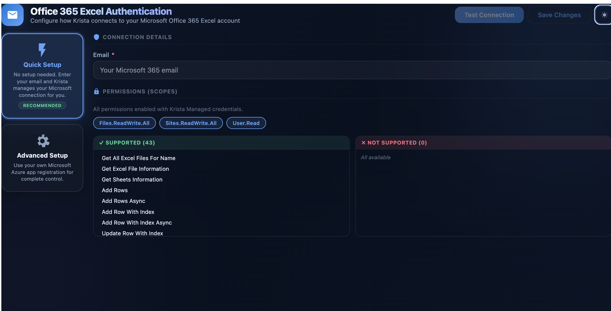
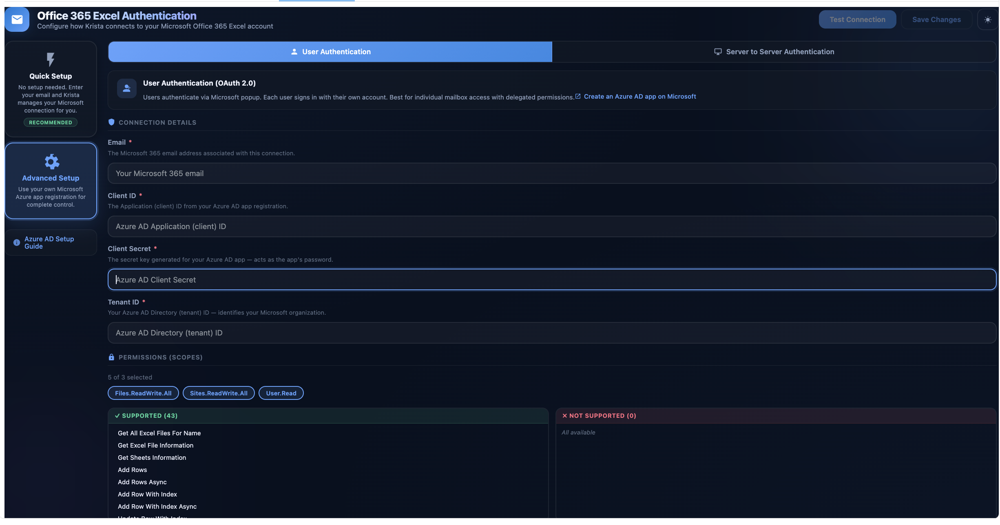
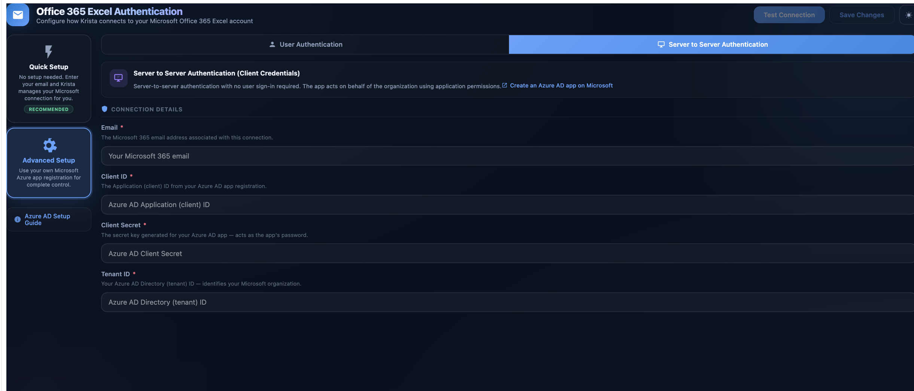

# Authentication

## Overview

The Office 365 Excel Extension uses Microsoft OAuth 2.0 and Azure AD authentication to securely connect with Microsoft Graph API. It supports three authentication configurations, each suited for different organizational needs:

| # | Configuration | Auth Flow | User Sign-In | Best For |
|---|--------------|-----------|--------------|----------|
| 1 | **Quick Setup** | Authorization Code (Delegated) | Yes | Quick setup, testing, small teams |
| 2 | **User Authentication (OAuth 2.0)** | Authorization Code (Delegated) | Yes | Enterprise control, custom permissions |
| 3 | **Server to Server Authentication** | Client Credentials (Application) | No | Automated workflows, no user interaction |

## Authentication Tab

The **Authentication** tab in the extension provides a unified interface for configuring all three types. The left sidebar lets you choose between:

- **Quick Setup** *(Recommended)* — Uses Krista's pre-registered Azure AD app; only an email address is needed
- **Advanced Setup** — Uses your own Azure AD app registration for full enterprise control

After selecting a type, enter the required fields, click **Test Connection**, and then **Save Changes**.

---

## Type 1: Quick Setup



### What It Is

Uses Krista's pre-registered Azure AD application for authentication. The user signs in via a browser popup and grants delegated permissions. No Azure portal configuration is required.

### When to Use

- Getting started quickly with minimal setup
- Development and testing environments
- Organizations where Azure AD app registration is not available
- Small teams that don't need custom permission policies

### Required Fields

| Field | Required | Description |
|-------|----------|-------------|
| Email | Yes | Microsoft 365 work or school email address |

### How It Works

1. Select **Quick Setup** from the left sidebar
2. Enter your Microsoft 365 email address
3. Click **Test Connection** — a Microsoft sign-in popup opens
4. Sign in with the email account and grant the requested permissions
5. After the popup closes, the connection is verified automatically
6. Click **Save Changes** to persist the configuration

### Authentication Flow

```
User clicks Test Connection
  → Browser popup opens Microsoft login page
  → User signs in and grants consent to Krista's Azure AD app
  → Microsoft returns authorization code to callback URL
  → Extension exchanges code for access + refresh tokens
  → Tokens stored securely under the invoker ID
  → Subsequent API calls use stored tokens with automatic refresh
```

### Scopes

All scopes are enabled automatically with Quick Setup:

| Scope | Purpose |
|-------|---------|
| `openid` | User authentication and identity |
| `offline_access` | Refresh token for long-term access |
| `Files.ReadWrite.All` | Read and write access to all Excel files the user can access |
| `Sites.ReadWrite.All` | Read and write access to SharePoint sites and drives |
| `User.Read` | Read basic user profile (used by Test Connection) |

### Limitations

- Cannot customize which scopes are requested
- Cannot apply organization-specific conditional access policies
- Cannot restrict to a single tenant
- Krista's Azure AD app is shared across all Quick Setup users

---

## Type 2: User Authentication (OAuth 2.0)



### What It Is

Uses your own Azure AD application for delegated authentication. The user still signs in via a browser popup, but authentication flows through your organization's Azure AD tenant. This provides full control over permissions, conditional access policies, and audit logging.

### When to Use

- Production environments requiring enterprise-grade security
- Organizations with conditional access or MFA policies
- When you need full audit trails through Azure AD logs
- When you need to restrict authentication to your tenant only

### Prerequisites

- A registered Azure AD application (see [Creating Microsoft App](pages/CreatingMicrosoftApp.md))
- Application (Client) ID, Client Secret, and Directory (Tenant) ID
- Delegated permissions granted with admin consent
- Redirect URI configured: `{extension-base-url}/rest/excel365extn/callback`

### Required Fields

| Field | Required | Description |
|-------|----------|-------------|
| Email | Yes | Microsoft 365 work or school email address |
| Client ID | Yes | Application (Client) ID from Azure AD app registration |
| Client Secret | Yes | Client secret value (not the secret ID) |
| Tenant ID | Yes | Directory (Tenant) ID from Azure AD |

### How It Works

1. Select **Advanced Setup** from the left sidebar
2. Select the **User Authentication** tab at the top
3. Enter email, Client ID, Client Secret, and Tenant ID
4. Click **Test Connection** — a Microsoft sign-in popup opens
5. Sign in and grant consent to your Azure AD app
6. After the popup closes, the connection is verified
7. Click **Save Changes** to persist the configuration

### Authentication Flow

```
User clicks Test Connection
  → Browser popup opens: https://login.microsoftonline.com/{tenant_id}/oauth2/v2.0/authorize
  → User authenticates against your Azure AD tenant
  → Conditional access policies and MFA are enforced
  → User grants consent to your Azure AD application
  → Microsoft returns authorization code to callback URL
  → Extension exchanges code + client_secret for access + refresh tokens
  → Tokens stored securely under the invoker ID
```

### Scope Configuration

When using User Authentication, you can toggle individual scopes in the **Permissions (Scopes)** panel on the Authentication tab. Only select the scopes that match the delegated permissions granted in your Azure AD app.

The Scopes panel shows which catalog requests each scope enables:

| Scope | Catalog Requests Enabled |
|-------|--------------------------|
| `Files.ReadWrite.All` | Get All Excel Files For Name, Get Excel File Information, Get Sheets Information, Add Rows, Add Row With Index, Update Row With Index, Add Data To Cell, Add Multiple Cell Data, Delete Sheet, Delete Row With Index, Delete Column With Index, Clear Sheet For Range, Find Value, Get Cell Value, Get Complete Row Info, Get Rows For Range, Execute Formula, Add Formula To Cell, Summation, Vlookup, and more |
| `Sites.ReadWrite.All` | Add Table Row, Get Table, Get Table Rows, Add Table Rows, Delete Table Row, Update Table Row, Get Tables, Get Drives, Get Excel Files In Drive, Get Excel Files In Folder, Get Shared Files |
| `User.Read` | Test Connection |

> **Important**: Ensure all selected scopes are granted as **delegated permissions** in your Azure AD app with admin consent. Missing scopes will cause specific catalog requests to fail.

### Redirect URI

Your Azure AD application must have the following redirect URI configured:

```
{extension-base-url}/rest/excel365extn/callback
```

To find the extension base URL:
1. Go to the extension's **Details** tab in Krista
2. Copy the base URL
3. Append `/rest/excel365extn/callback`

Example: `https://extension.solution.eng.krista.app/extension/api/xAcwhzRYmXuSToCNf4ropQ_e_e/rest/excel365extn/callback`

---

## Type 3: Server to Server Authentication



### What It Is

Uses the OAuth 2.0 Client Credentials flow for app-only authentication. No user sign-in is required. The extension authenticates directly as the application using Client ID and Client Secret, and accesses files via the `/users/{email}` endpoint instead of `/me`.

### When to Use

- Fully automated workflows where no user is present to sign in
- Background processing and scheduled tasks
- Server-to-server integrations
- When the application needs to access Excel files on behalf of the organization

### Prerequisites

- A registered Azure AD application (see [Creating Microsoft App](pages/CreatingMicrosoftApp.md))
- Application (Client) ID, Client Secret, and Directory (Tenant) ID
- **Application permissions** (not delegated) granted with admin consent:
  - `Files.ReadWrite.All` (Application)
  - `Sites.ReadWrite.All` (Application)
- Redirect URI is **not required** for this flow

### Required Fields

| Field | Required | Description |
|-------|----------|-------------|
| Email | Yes | The target mailbox email address to access files on behalf of |
| Client ID | Yes | Application (Client) ID from Azure AD app registration |
| Client Secret | Yes | Client secret value (not the secret ID) |
| Tenant ID | Yes | Directory (Tenant) ID from Azure AD |

### How It Works

1. Select **Advanced Setup** from the left sidebar
2. Select the **Server to Server Authentication** tab at the top
3. Enter email, Client ID, Client Secret, and Tenant ID
4. Click **Test Connection** — no browser popup; the extension authenticates directly
5. If successful, click **Save Changes** to persist the configuration

### Authentication Flow

```
Extension sends POST to:
  https://login.microsoftonline.com/{tenant_id}/oauth2/v2.0/token

  client_id={your_client_id}
  &client_secret={your_client_secret}
  &grant_type=client_credentials
  &scope=https://graph.microsoft.com/.default

  → Microsoft validates client credentials
  → Returns access token (no refresh token)
  → Extension uses /users/{email}/... endpoints (not /me)
  → Token cached and refreshed automatically before expiry
```

### Key Differences from User Authentication

| Aspect | User Authentication (Type 2) | Server to Server Authentication (Type 3) |
|--------|------------------------------|------------------------------------------|
| User sign-in | Required | Not required |
| Token type | Delegated (user + app) | Application-only |
| Graph API path | `/me/...` | `/users/{email}/...` |
| Refresh token | Yes | No (new token requested on expiry) |
| Permissions type | Delegated | Application |
| Scopes panel | Available | Not applicable |

### Azure AD Application Permissions

For Server to Server Authentication, you need **Application permissions** (not delegated):

1. Go to Azure AD > App registrations > your app > API permissions
2. Click **Add a permission** > **Microsoft Graph** > **Application permissions**
3. Add required permissions:
   - `Files.ReadWrite.All` — Read and write files in all site collections
   - `Sites.ReadWrite.All` — Read and write items in all site collections
4. Click **Grant admin consent for [Your Organization]**

> **Important**: Application permissions grant access to **all files** across the organization. The `Email` field in the configuration determines which specific user's files the extension operates on.

---

## Token Management

### Access Tokens

| Property | User Authentication (Types 1 & 2) | Server to Server Authentication (Type 3) |
|----------|-----------------------------------|------------------------------------------|
| Lifetime | ~1 hour | ~1 hour |
| Refresh | Via refresh token | New client_credentials request |
| Storage | Encrypted, per-invoker | Encrypted, per-invoker |

### Automatic Token Handling

The extension automatically handles:
- Token expiration detection before API calls
- Token refresh (or re-acquisition for Server to Server Authentication)
- Retry logic for transient failures
- Secure token storage and encryption
- Token cleanup on disconnection

### Token Errors

When a token-related error occurs, the extension classifies it and takes appropriate action:

| Error | Action | Re-auth Required |
|-------|--------|-----------------|
| Token expired | Remove stored token, prompt re-authentication | Yes |
| Password changed | Remove stored token, prompt re-authentication | Yes |
| Permissions revoked | Remove stored token, prompt re-consent | Yes |
| Invalid client secret | Surface error, keep token | No |
| User not found | Surface error, keep token | No |
| Service unavailable | Retry, keep token | No |

---

## Audit Dashboard

The **Excel Audit Dashboard** tab provides visibility into authentication events and catalog request activity. Every catalog request is automatically tracked:

| Event | When Recorded |
|-------|---------------|
| `CATALOG_REQUEST_TRIGGERED` | When a catalog request starts execution |
| `CATALOG_REQUEST_SUCCESS` | When a catalog request completes successfully |
| `CATALOG_REQUEST_FAILURE` | When a catalog request fails (validation error, exception, or auth error) |
| `TOKEN_REFRESHED` | When an access token is successfully refreshed |
| `TOKEN_EXPIRY_DETECTED` | When a token expiration error is caught |
| `PASSWORD_CHANGE_DETECTED` | When a password change error is caught |
| `INVALID_CLIENT_SECRET_DETECTED` | When a client secret error is caught |

The audit dashboard shows:
- **Credential Health** — current status of stored authentication credentials
- **Event Timeline** — chronological list of all audit events
- **Request Tracking** — each TRIGGERED event is paired with its SUCCESS or FAILURE outcome, including duration and execution logs

---

## Troubleshooting

### Test Connection Fails with No Popup (User Authentication)

**Cause**: Browser popup blocked or redirect URI mismatch.
**Fix**: Allow popups for the Krista domain. Verify the redirect URI in Azure AD matches exactly: `{base-url}/rest/excel365extn/callback`.

### Test Connection Fails Immediately (Server to Server Authentication)

**Cause**: Invalid Client ID, Client Secret, or Tenant ID.
**Fix**: Verify all three values are copied correctly from Azure AD. Check that the client secret has not expired.

### Standard Users Cannot Sign In (User Authentication — Your Own Azure AD App)

**Cause**: Missing delegated scopes or incorrect permission types.
**Fix**: Ensure `Files.ReadWrite.All` and `Sites.ReadWrite.All` delegated scopes are granted with admin consent. Do not use Application permissions for delegated flows. See [Creating Microsoft App](pages/CreatingMicrosoftApp.md) for details.

### Token Refresh Fails After Password Change

**Cause**: The stored refresh token is invalidated when the user changes their password.
**Fix**: Re-authenticate by clicking **Test Connection** and signing in again.

### "Not Supported" Catalog Requests in Scope Panel

**Cause**: A required scope is not selected in the scope panel.
**Fix**: Toggle on the missing scope shown next to the catalog request in the "Not Supported" column.

### AADSTS Error Codes

| Error Code | Meaning | Fix |
|-----------|---------|-----|
| AADSTS70002 | Invalid credentials | Verify Client ID, Secret, and Tenant ID |
| AADSTS65001 | Consent not granted | Request admin consent in Azure AD |
| AADSTS50011 | Redirect URI mismatch | Fix redirect URI in Azure AD app |
| AADSTS70008 | Refresh token expired | Re-authenticate via Test Connection |
| AADSTS7000222 | Client secret expired | Generate a new client secret in Azure AD |

---

## Security Best Practices

1. **Use Server to Server Authentication for automated workflows** — avoids dependency on user tokens that can expire when passwords change
2. **Rotate client secrets regularly** — set a reminder before the expiration date
3. **Use User Authentication for production** — provides full control and audit trails
4. **Grant minimal permissions** — only add the scopes your workflows actually need
5. **Monitor the Audit Dashboard** — watch for `TOKEN_EXPIRY_DETECTED` and `INVALID_CLIENT_SECRET_DETECTED` events

---

## See Also

- [Extension Configuration](pages/ExtensionConfiguration.md) — Step-by-step setup for each auth type
- [Creating Microsoft App](pages/CreatingMicrosoftApp.md) — Azure AD application registration guide
