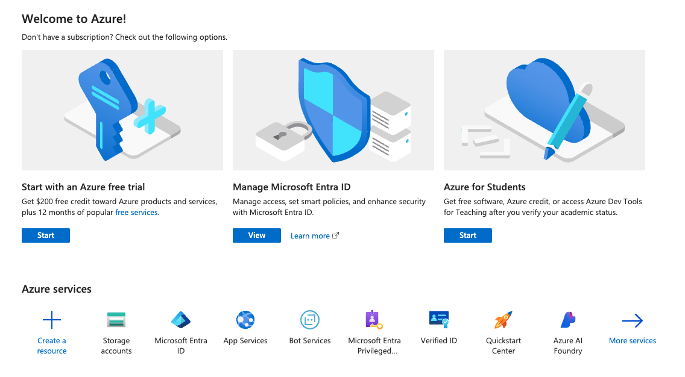
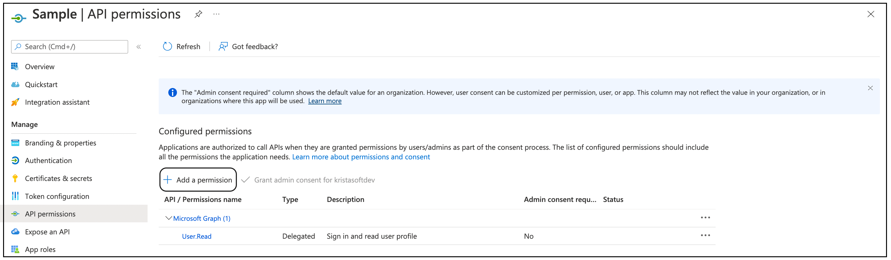

# Creating Microsoft Azure Application

## Overview

To use the Office 365 Excel Extension, you must create and configure an application in Microsoft Entra ID. This application provides the OAuth 2.0 credentials required for the extension to authenticate and access Microsoft Graph API.

This guide provides step-by-step instructions for creating an Microsoft Entra ID application, configuring permissions, and obtaining the necessary credentials.

## Prerequisites

Before you begin, ensure you have:

- **Microsoft Azure Account**: Active Azure subscription with administrative access
- **Microsoft Entra ID Tenant**: Access to an Microsoft Entra ID tenant
- **Administrative Permissions**: Ability to register applications and grant admin consent
- **Office 365 Subscription**: Active Office 365 subscription with Excel Online

## Step-by-Step Instructions

### Step 1: Access Azure Portal

1. Open your web browser and navigate to the [Azure Portal](https://portal.azure.com/)
2. Sign in with your Microsoft account that has administrative access
3. Wait for the Azure portal dashboard to load

### Step 2: Navigate to Microsoft Entra ID

1. On the Azure portal home page, locate **Azure services** section
2. Click on **Microsoft Entra ID** (formerly Azure Active Directory)
3. If you don't see it immediately, click **More services** to find it
4. Alternatively, use the search bar at the top and type "Microsoft Entra ID"

> **📝 Note**: Microsoft Entra ID is the new name for Azure Active Directory. The functionality remains the same.

### Step 3: Access App Registrations

1. In the Microsoft Entra ID overview page, locate the left navigation menu
2. Under the **Manage** section, click **App registrations**
3. This page displays all registered applications in your tenant

### Step 4: Create New Application Registration

1. At the top of the App registrations page, click **+ New registration**
2. If you already have an application registered for this purpose, you can select it instead

### Step 5: Configure Application Registration

Fill in the application registration form with the following details:

#### Name
- Enter a descriptive name for your application
- Example: "Krista Office 365 Excel Extension"
- This name will be visible to users during authentication

#### Supported Account Types
Select the appropriate option based on your requirements:

- **Accounts in this organizational directory only (Single tenant)** - Recommended
  - Use this for internal organizational use
  - Most secure option
  - Users must be in your Microsoft Entra ID tenant

- **Accounts in any organizational directory (Multi-tenant)**
  - Use if you need to support users from multiple organizations
  - Requires additional security considerations

- **Accounts in any organizational directory and personal Microsoft accounts**
  - Not recommended for enterprise use
  - Broadest access but least secure

#### Redirect URI
1. Select **Web** as the platform from the dropdown
2. Enter the redirect URI for your Krista instance
3. Format: `https://<your-krista-domain>/excel365extn/callback`
4. Example: `https://krista.yourcompany.com/excel365extn/callback`

> **⚠️ Warning**: The redirect URI must match exactly what you configure in the Krista extension. Any mismatch will cause authentication failures.

#### Complete Registration
Click the **Register** button to create the application

### Step 6: Obtain Client ID and Tenant ID

After successful registration, you'll be redirected to the application's overview page.

1. Locate the **Essentials** section at the top of the page
2. Find and copy the **Application (client) ID**
   - This is your **Client ID**
   - Format: `xxxxxxxx-xxxx-xxxx-xxxx-xxxxxxxxxxxx`
   - Save this value securely
3. Find and copy the **Directory (tenant) ID**
   - This is your **Tenant ID**
   - Format: `xxxxxxxx-xxxx-xxxx-xxxx-xxxxxxxxxxxx`
   - Save this value securely

> **📝 Note**: You'll need both the Client ID and Tenant ID when configuring the extension in Krista.

### Step 7: Configure API Permissions

The application needs specific Microsoft Graph API permissions to access Excel files.

#### Add Permissions
1. In the left navigation menu, click **API permissions**
2. You'll see some default permissions already configured
3. Click **+ Add a permission** button

#### Select Microsoft Graph
1. In the "Request API permissions" panel, click **Microsoft Graph**
2. This is the API that provides access to Office 365 services

#### Choose Permission Type
1. Select **Delegated permissions**
2. Delegated permissions allow the app to act on behalf of a signed-in user

> **📝 Note**: Do not select "Application permissions" as the extension uses delegated access with user authentication.

#### Select Required Permissions
In the permissions search box, search for and select the following permissions:

**Required Permissions**:
- ✅ **openid** - Required for OpenID Connect authentication
- ✅ **offline_access** - Required to obtain refresh tokens
- ✅ **Files.ReadWrite** - Read and write user's files
- ✅ **Files.ReadWrite.All** - Read and write all files user can access

**Optional Permissions** (for extended functionality):
- **Sites.Read.All** - Read items in all site collections (if accessing SharePoint sites)

After selecting all required permissions, click **Add permissions**

#### Grant Admin Consent
1. After adding permissions, you'll see them listed under "Configured permissions"
2. Click **Grant admin consent for [Your Organization]**
3. Confirm the action in the popup dialog
4. Wait for the status to change to "Granted"

> **⚠️ Warning**: Admin consent is required for the extension to function. Without it, users will be unable to authenticate.

### Step 8: Create Client Secret

The client secret is used to authenticate the application when exchanging authorization codes for tokens.

#### Navigate to Certificates & Secrets
1. In the left navigation menu, click **Certificates & secrets**
2. Select the **Client secrets** tab

#### Add New Client Secret
1. Click **+ New client secret** button
2. In the "Add a client secret" panel, provide the following:

**Description**:
- Enter a meaningful description
- Example: "Krista Excel Extension Secret"
- This helps identify the secret's purpose

**Expires**:
- Select an expiration period:
  - **90 days** - More secure, requires frequent rotation
  - **180 days** - Balanced approach
  - **365 days** - Less frequent rotation
  - **Custom** - Specify exact date
  - **24 months** - Maximum allowed

> **💡 Tip**: Choose 90 or 180 days for better security. Set a reminder to rotate the secret before expiration.

3. Click **Add** to create the secret

#### Copy Client Secret Value
1. After creation, the secret **Value** will be displayed
2. **IMPORTANT**: Copy this value immediately and store it securely
3. This is your **Client Secret**
4. The value will never be shown again after you navigate away

> **⚠️ Critical**: If you lose the client secret value, you cannot retrieve it. You must create a new client secret.

**Security Best Practices**:
- Store the secret in a secure password manager or Azure Key Vault
- Never commit the secret to source control
- Never share the secret via email or messaging
- Rotate the secret regularly (every 90 days recommended)

### Step 9: Configure Additional Redirect URIs (Optional)

If you need to add additional redirect URIs for different environments:

1. In the left navigation menu, click **Authentication**
2. Under **Platform configurations**, find the **Web** section
3. Click **Add URI** to add additional redirect URIs
4. Enter each URI and click **Save**

**Common Scenarios**:
- Development environment: `https://dev.krista.yourcompany.com/excel365extn/callback`
- Staging environment: `https://staging.krista.yourcompany.com/excel365extn/callback`
- Production environment: `https://krista.yourcompany.com/excel365extn/callback`

### Step 10: Review Application Settings

Before proceeding, verify all settings are correct:

**Application Overview**:
- ✅ Application name is descriptive
- ✅ Client ID is copied and saved
- ✅ Tenant ID is copied and saved

**API Permissions**:
- ✅ Microsoft Graph permissions are added
- ✅ Admin consent is granted
- ✅ Status shows "Granted for [Your Organization]"

**Certificates & Secrets**:
- ✅ Client secret is created
- ✅ Secret value is copied and stored securely
- ✅ Expiration date is noted

**Authentication**:
- ✅ Redirect URI is configured
- ✅ Redirect URI matches Krista extension configuration

## Verification

To verify your Microsoft Entra ID application is configured correctly:

1. **Check Application Status**:
   - Navigate to App registrations
   - Ensure your application appears in the list
   - Status should be "Enabled"

2. **Verify Permissions**:
   - Open your application
   - Go to API permissions
   - Confirm all required permissions show "Granted" status

3. **Test Authentication** (after configuring Krista extension):
   - Configure the extension in Krista with obtained credentials
   - Click "Validate" to test authentication
   - Successful authentication confirms correct setup

## Next Steps

After creating and configuring your Microsoft Entra ID application:

1. **Configure Krista Extension**:
   - Navigate to [Extension Configuration](pages/ExtensionConfiguration.md)
   - Enter the Client ID, Tenant ID, and Client Secret
   - Configure the redirect URI
   - Validate the configuration

2. **Set Up Authentication**:
   - Review [Authentication](pages/Authentication.md) guide
   - Choose appropriate authentication mode
   - Test authentication flow

3. **Start Using the Extension**:
   - Explore available catalog requests
   - Create your first workflow
   - Test with sample Excel files

## Troubleshooting

### Issue: Cannot Create App Registration

**Cause**: Insufficient permissions in Microsoft Entra ID

**Resolution**:
1. Contact your Microsoft Entra ID administrator
2. Request "Application Developer" or "Application Administrator" role
3. Alternatively, ask admin to create the application for you

### Issue: Cannot Grant Admin Consent

**Cause**: Lack of administrative privileges

**Resolution**:
1. Contact your Microsoft Entra ID Global Administrator
2. Request them to grant admin consent for the permissions
3. Provide them with the application name and required permissions list

### Issue: Client Secret Not Visible

**Cause**: Navigated away from the page before copying

**Resolution**:
1. The secret value cannot be retrieved
2. Delete the existing secret
3. Create a new client secret
4. Copy the value immediately

### Issue: Redirect URI Mismatch Error

**Cause**: Redirect URI in Azure doesn't match Krista configuration

**Resolution**:
1. Verify the exact redirect URI from Krista extension details
2. Ensure it's added to Microsoft Entra ID application's redirect URIs
3. Check for typos, extra spaces, or protocol mismatches (http vs https)
4. Save changes in Azure portal

### Issue: Permission Consent Required Error

**Cause**: Admin consent not granted for permissions

**Resolution**:
1. Navigate to API permissions in Microsoft Entra ID application
2. Click "Grant admin consent for [Your Organization]"
3. Wait a few minutes for changes to propagate
4. Retry authentication

## Security Considerations

### Application Security
- **Limit Access**: Only grant necessary permissions
- **Monitor Usage**: Regularly review application sign-in logs
- **Rotate Secrets**: Change client secrets every 90 days
- **Use Certificates**: Consider using certificates instead of secrets for enhanced security

### Permission Management
- **Principle of Least Privilege**: Only request permissions you need
- **Regular Audits**: Review granted permissions quarterly
- **Remove Unused Apps**: Delete applications no longer in use

### Compliance
- **Data Residency**: Ensure compliance with data residency requirements
- **Audit Logs**: Enable and monitor Microsoft Entra ID audit logs
- **Conditional Access**: Configure conditional access policies for additional security

## See Also

- [Extension Configuration](pages/ExtensionConfiguration.md) - Configure the extension in Krista
- [Authentication](pages/Authentication.md) - Understand authentication flows and token management
- [Release Notes](pages/releaseNotes.md) - Version information and updates
- [Microsoft Documentation](https://docs.microsoft.com/en-us/azure/active-directory/develop/) - Official Microsoft Entra ID documentation

