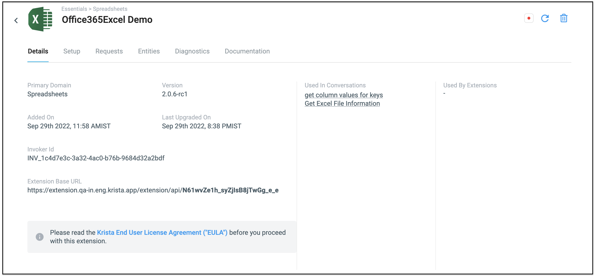
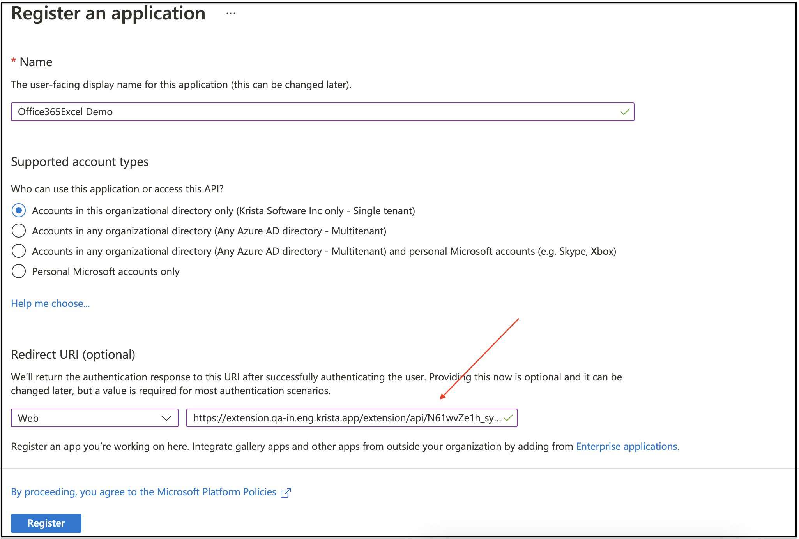

# Extension Configuration

## Overview

The Office 365 Excel Extension requires proper configuration to connect with Microsoft Graph API and access Excel files
in OneDrive and SharePoint. This guide provides step-by-step instructions for configuring the extension within your
Krista environment.

## Configuration Parameters

The following parameters are required to configure the Office 365 Excel Extension:

| Parameter     | Type    | Required | Description                                                     | Example                                                  |
|---------------|---------|----------|-----------------------------------------------------------------|----------------------------------------------------------|
| Client ID     | Text    | Yes      | OAuth 2.0 client identifier from Microsoft Entra ID application | "a1b2c3d4-e5f6-7890-abcd-ef1234567890"                   |
| Client Secret | Text    | Yes      | OAuth 2.0 client secret from Microsoft Entra ID application     | "xYz~AbC123.dEf456-GhI789"                               |
| Tenant ID     | Text    | Yes      | Microsoft Entra ID tenant identifier                            | "12345678-90ab-cdef-1234-567890abcdef"                   |
| Redirect URI  | Text    | Yes      | OAuth callback URL for authentication flow                      | "https://your-krista-instance.com/excel365extn/callback" |
| Email         | Text    | Yes      | Administrator email for service account authentication          | "admin@yourcompany.com"                                  |
| Allow Retry   | Boolean | No       | Enable automatic retry for transient failures                   | true                                                     |

## Step-by-Step Setup

### 1. Access Extension Configuration

1. Log in to your Krista application
2. Navigate to **Extensions** in the main menu
3. Locate **Office 365 Excel Extension** in the extensions list
4. Click **Configure** or **Setup**

### 2. Obtain Microsoft Entra ID Credentials

Before configuring the extension, you must create an Microsoft Entra ID application and obtain the required credentials:

- Follow the [Creating Microsoft App](pages/CreatingMicrosoftApp.md) guide to:
    - Create an Microsoft Entra ID application
    - Configure API permissions
    - Generate client credentials
    - Set up redirect URIs

### 3. Enter Configuration Parameters

#### Client ID

1. In the Azure portal, navigate to your registered application
2. Go to the **Overview** page
3. Copy the **Application (client) ID**
4. Paste it into the **Client ID** field in Krista

#### Tenant ID

1. On the same **Overview** page in Azure portal
2. Copy the **Directory (tenant) ID**
3. Paste it into the **Tenant ID** field in Krista

#### Client Secret

1. In the Azure portal, navigate to **Certificates & secrets**
2. Under **Client secrets**, click **New client secret**
3. Add a description and select expiration period
4. Click **Add**
5. **Important**: Copy the secret **Value** immediately (it won't be shown again)
6. Paste it into the **Client Secret** field in Krista

#### Redirect URI

1. In Krista, navigate to the extension **Details** tab
2. Copy the **Extension Base URL**
3. Append `/excel365extn/callback` to the base URL
4. The complete redirect URI should look like: `https://your-krista-instance.com/excel365extn/callback`
5. Enter this URI in the **Redirect URI** field

6. **Important**: Also add this same redirect URI in the Azure portal:
    - Navigate to your Microsoft Entra ID application
    - Go to **Authentication** > **Platform configurations**
    - Add the redirect URI under **Web** platform

#### Email

1. Enter the email address of the administrator account
2. This email will be used for service account authentication
3. A refresh token will be generated and linked to this email after authentication

### 4. Authentication Type Selection

Choose the appropriate authentication mode for your use case:

#### Service Account Authentication

- **When to use**: For automated workflows that don't require user-specific permissions
- **Configuration**: Uncheck "Have people authenticate with their account" in the invoker
- **Behavior**: All operations execute using the configured administrator account

#### User Account Authentication

- **When to use**: For workflows requiring user-specific permissions and data access
- **Configuration**: Check "Have people authenticate with their account" in the invoker
- **Behavior**: Each user must authenticate with their own Microsoft account

See [Authentication](pages/Authentication.md) for detailed information about authentication modes.

### 5. Redirect URI Configuration

The redirect URI is critical for OAuth 2.0 authentication flow:

1. **Krista Configuration**: Enter the complete callback URL in the extension setup
2. **Azure Configuration**: Add the same URL to the Microsoft Entra ID application's redirect URIs
3. **Format**: `https://<krista-instance-domain>/excel365extn/callback`
4. **Verification**: Ensure both configurations match exactly (including protocol, domain, and path)

> **⚠️ Warning**: Mismatched redirect URIs will cause authentication failures.

### 6. Allow Retry Flag

The retry mechanism helps handle transient failures:

- **Enabled (true)**: Automatically retries failed requests due to rate limiting or temporary network issues
- **Disabled (false)**: No automatic retries; failures are immediately returned
- **Default**: true
- **Recommendation**: Keep enabled for production environments

**Retry Behavior**:

- Maximum retry attempts: 3
- Exponential backoff strategy
- Applies to: Rate limiting (429), temporary server errors (503)
- Does not retry: Authentication errors, invalid input, permanent failures

### 7. Validate Configuration

1. After entering all parameters, click **Validate**
2. An authentication window will open
3. Sign in with the administrator account specified in the Email field
4. Grant the requested permissions
5. Upon successful authentication, you'll be redirected back to Krista
6. A success message confirms the configuration is valid

### 8. Test Connection

1. Click **Test Connection** on the setup page
2. The extension will attempt to:
    - Authenticate using the configured credentials
    - Access Microsoft Graph API
    - Retrieve basic user information
3. A success message indicates the extension is ready to use
4. If the test fails, review error messages and verify all configuration parameters

## Security Considerations

### Credential Management

- **Never share** client secrets or expose them in logs
- **Rotate secrets** regularly (recommended: every 90 days)
- **Use Azure Key Vault** for production environments when possible
- **Limit access** to extension configuration to authorized administrators only

### Permission Scope

- Grant only the **minimum required permissions**:
    - `Files.ReadWrite`: Access user's files
    - `Files.ReadWrite.All`: Access all files (required for shared drives)
- Avoid granting unnecessary admin permissions

### Token Security

- Refresh tokens are encrypted and stored securely in Krista
- Access tokens are short-lived (1 hour) and automatically refreshed
- Tokens are never exposed in API responses or logs

### Network Security

- Use **HTTPS only** for redirect URIs
- Ensure Krista instance is accessible via secure connection
- Configure firewall rules to allow Microsoft Graph API endpoints

## Troubleshooting

### Common Configuration Issues

#### Issue: "Invalid Client" Error

**What it means**: The extension cannot connect to Microsoft because the Client ID or Client Secret is incorrect.

**How to fix**:

1. Open your Azure portal and navigate to your app registration
2. Verify the Client ID matches exactly (no extra spaces)
3. If the Client Secret has expired, generate a new one:
   - Go to "Certificates & secrets" → "New client secret"
   - Copy the new secret value immediately (it won't be shown again)
   - Update the extension configuration with the new secret
4. Save and validate the configuration again

#### Issue: "Redirect URI Mismatch" Error

**What it means**: The redirect URI configured in Krista doesn't match what's registered in Azure.

**How to fix**:

1. In Krista, copy the exact redirect URI shown in the extension configuration
2. In Azure portal, go to your app registration → "Authentication"
3. Under "Redirect URIs", click "Add URI" and paste the exact URI from Krista
4. Ensure the protocol (https://), domain, and path match exactly - even a single character difference will cause this error
5. Click "Save" in Azure, then retry validation in Krista

#### Issue: "Insufficient Permissions" Error

**What it means**: The extension doesn't have the required permissions to access Excel files in your Microsoft environment.

**How to fix**:

1. In Azure portal, navigate to your app registration → "API permissions"
2. Click "Add a permission" → "Microsoft Graph" → "Application permissions"
3. Search for and add: **Files.ReadWrite.All**
4. Click "Grant admin consent for [Your Organization]" (requires admin privileges)
5. Wait 2-3 minutes for permissions to propagate across Microsoft's systems
6. Retry validation in Krista

#### Issue: "Token Expired" During Validation

**What it means**: Your authentication session timed out before you completed the sign-in process.

**How to fix**:

1. Clear your browser cache and cookies for Microsoft login pages
2. Close any open Microsoft authentication windows
3. Click "Validate Attributes" again to start fresh
4. Complete the entire sign-in process within 10 minutes
5. If you're using multi-factor authentication, have your phone/authenticator app ready

#### Issue: Test Connection Fails

**What it means**: The extension cannot successfully connect to Microsoft Graph API.

**How to fix**:

1. **Verify configuration**: Double-check all parameters (Client ID, Client Secret, Tenant ID, Redirect URI)
2. **Check account permissions**: Ensure the account you're signing in with has:
   - An active Office 365 license
   - Permission to access Excel files in OneDrive or SharePoint
3. **Test network connectivity**: Ensure your network allows connections to:
   - `https://graph.microsoft.com`
   - `https://login.microsoftonline.com`
4. **Review error details**: Check Krista logs for specific error messages that indicate the root cause
5. **Wait and retry**: If Microsoft services are experiencing issues, wait 5-10 minutes and try again

### Getting Help

If you continue to experience issues:

1. Review the [Authentication Guide](pages/Authentication.md) for authentication-specific problems
2. Check [Creating Microsoft App](pages/CreatingMicrosoftApp.md) for Azure setup issues
3. Consult Krista support with error messages and configuration details

## Next Steps

After successful configuration:

1. Review [Authentication](pages/Authentication.md) to understand authentication flows
2. Explore available [Catalog Requests](pages/README.md#catalog-requests)
3. Create your first workflow using Office 365 Excel operations
4. Test with sample Excel files before production use

## See Also

- [Authentication](pages/Authentication.md) - OAuth 2.0 flows and token management
- [Creating Microsoft App](pages/CreatingMicrosoftApp.md) - Microsoft Entra ID application setup
- [Release Notes](pages/releaseNotes.md) - Version information and updates

